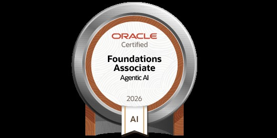

 
<strong>B.Tech CSE (Data Science) · PEC Chandigarh · Class of 2027</strong>
 

 

Hey, I'm Sujal 👋
I build AI-powered products and backend systems. I'm especially interested in making LLM applications reliable enough for real workflows — not just demos.
- Currently building: Sentinel-SRE, an AI-powered incident investigation and root-cause analysis platform.
- Previously shipped: LexGuard AI, a multi-tenant compliance analysis SaaS.
- Industry experience: Data Analyst & Automation Intern at BHEL, working with Python, SQL, forecasting, and operational dashboards.
- Also built: Tab Hibernator Pro, a published Chrome extension that reached 2,400+ weekly active users at its peak.
- Open to: AI engineering, backend, full-stack, and 2027 graduate software engineering opportunities.
Selected work
<table>
  <tr>
    <td width="50%" valign="top">
      <h3>⚡ Sentinel-SRE</h3>
      
<strong>AI-powered incident RCA &amp; observability</strong>

      
Turns Prometheus alerts into root-cause hypotheses through retrieval, structured reasoning, and guardrails.

      
<code>Python</code> <code>FastAPI</code> <code>LlamaIndex</code> <code>ChromaDB</code> <code>Docker</code> <code>AWS</code>

      
<strong>Engineering focus:</strong> Non-blocking APIs with detached inference workers; measured sub-200 ms P99 API latency.

      
<a href="https://sentinelsre.vercel.app"><strong>Explore live project ↗</strong></a>

    </td>
    <td width="50%" valign="top">
      <h3>🛡️ LexGuard AI</h3>
      
<strong>Multi-tenant AI compliance SaaS</strong>

      
Analyzes DPDP Act clauses to produce structured risk flags and remediation recommendations.

      
<code>Next.js</code> <code>FastAPI</code> <code>LangChain</code> <code>PostgreSQL</code> <code>Docker</code> <code>AWS</code>

      
<strong>Engineering focus:</strong> Role-based access control, relational data modeling, and containerized deployment.

      
<a href="https://lexguard.co.in"><strong>Explore live project ↗</strong></a>

    </td>
  </tr>
</table>

<strong>More things I've built</strong>

<strong>Tab Hibernator Pro — Chrome extension:</strong> Reduces inactive-tab memory use while protecting active media and form inputs. Reached 2.4K+ weekly active users at peak.

<strong>Warehouse optimization — BHEL:</strong> Built Python/SQL pipelines, forecasting models, and KPI dashboards for inventory monitoring and reorder planning.

Toolbox
Languages & frameworks

AI & data

Applied AI: RAG · LLM agents · LlamaIndex · ChromaDB · Vector search · Prompt engineering
Cloud & tooling

Certification
<table>
  <tr>
    <td width="135" align="center" valign="middle">
      
    </td>
    <td valign="middle">
      <strong>Oracle Certified Foundations Associate — Agentic AI</strong> 
      Oracle University · Issued November 2026 
      Agentic AI foundations · LLMs · AI agents and workflows
    </td>
  </tr>
</table>GitHub activity

<strong>Let's build something useful.</strong> 
<a href="https://www.sujalmeena.xyz/">Portfolio</a> · <a href="https://linkedin.com/in/sujal-meena-170418371">LinkedIn</a> · <a href="https://peerlist.io/meenasujal">Peerlist</a> · <a href="https://x.com/sujal_meena_">X</a> · <a href="mailto:meenasujal60@gmail.com">Email</a> 
Open to engineering internships and 2027 graduate opportunities.

